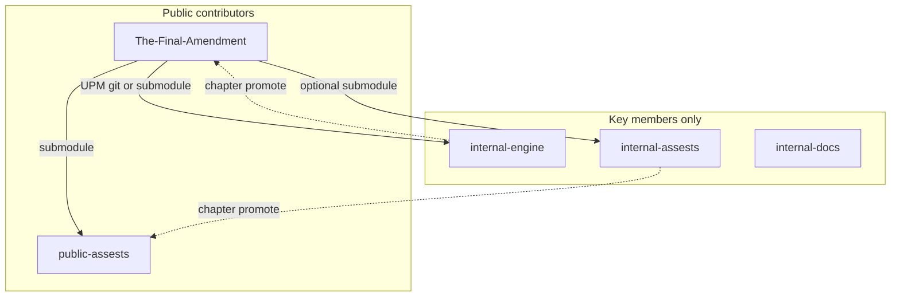

# The Final Amendment — Modules & chapter promote

YARG-style split for Project Dusk. Sibling repos under **ActivityTerminal2**.

## Repo map

| Role | Repo | Visibility |
|------|------|------------|
| Public engine + Unity host | [The-Final-Amendment](https://github.com/ActivityTerminal2/The-Final-Amendment) | public when ready for community PRs |
| Private engine (story + online/server) | [internal-engine](https://github.com/ActivityTerminal2/internal-engine) | **private** |
| Released assets | [public-assests](https://github.com/ActivityTerminal2/public-assests) | public when shipping |
| Testing assets | [internal-assests](https://github.com/ActivityTerminal2/internal-assests) | **private** |
| This docs repo | [internal-docs](https://github.com/ActivityTerminal2/internal-docs) | **private** |

Spelling `assests` matches GitHub.

Host clone recipes: [docs/MODULES.md in The-Final-Amendment](https://github.com/ActivityTerminal2/The-Final-Amendment/blob/main/docs/MODULES.md) (once pushed). Local path: `The-Final-Amendment/docs/MODULES.md`.



## Ownership

- **The-Final-Amendment:** combat, arenas, core, input, UI, rendering, offline/LAN, client builds, player-facing docs.
- **internal-engine:** story/campaign, ranked/online/dedicated, brand boot, server tooling (`com.activityterminal2.internal-engine`).
- **public-assests:** released meshes, HUD, generic audio, stats-only data.
- **internal-assests:** WIP portraits, VO, lore SOs, unreleased maps/vehicles.
- **internal-docs:** planning, prompts, character bibles, engineering notes.

## Key-member wire-up

From The-Final-Amendment:

```bash
chmod +x Modules/setup-key-member.sh
./Modules/setup-key-member.sh
```

Adds `Assets/Content/Public` + `Assets/Content/Internal` submodules and merges internal-engine into `Packages/manifest.json`. Remove in-tree `Assets/_ProjectDusk/Scripts/Internal` after the UPM package imports (asmdef name clash).

## Chapter promote checklist

1. Stabilize story/online features in **internal-engine**.
2. Freeze shipped art/audio/data in **internal-assests**.
3. Copy/move shipped folders into **public-assests**; keep WIP private.
4. Tag both asset repos to the chapter id (e.g. `v0.1.0-chapter0`).
5. Promote only required public APIs (prefer interfaces); leave secrets/server code private.
6. Pin The-Final-Amendment release to the new **public-assests** tag.
7. Strip **internal-engine** / **internal-assests** from public CI and community clone docs.
8. Add a chapter note under `the-final-amendment/` here (date, tag, what shipped).
9. Smoke-test: community-style clone (host + public-assests only) still boots Quick Match.

## Characters (lore)

| Doc | Subject |
|-----|---------|
| [characters/marcus-vance.md](characters/marcus-vance.md) | Marcus Vance / Glitch (Tick) |
| [back-story.txt](back-story.txt) | Original lore dump |

## Related host files

- `Modules/README.md`, `Modules/setup-key-member.sh`, `.gitmodules.example`
- `docs/MODULES.md`, `docs/INTERNAL.md`
- `Assets/_ProjectDusk/Scripts/Internal/` (scaffold → package)
- `ProjectDusk.Core.IContentCatalog`, `NetworkSessionFactory.InternalSessionFactory`
