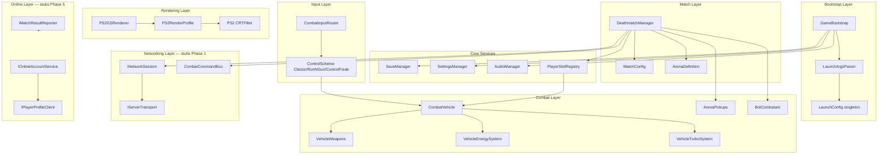

# Project Dusk — Architecture Overview

High-level map of systems, data flow, and extension points. Phase 1 ships offline deathmatch; multiplayer and online services are stubbed for later phases.

---

## Design Principles

1. **No singleton "the player"** — resolve `PlayerSlotId` → `ILocalCombatant` → `CombatVehicle`.
2. **Server-authoritative mutations** — damage, pickups, and match state go through `CombatCommandBus` (LAN-ready from day one).
3. **GS-only rendering** — quality tiers scale Enhanced GS knobs; URP Lit/PBR is never enabled.
4. **Data-driven content** — vehicles, arenas, weapons, and pickups are ScriptableObjects.
5. **AI traceability** — Meshy and Venice assets carry metadata components; code tagged `@ai-generated`.

---

## System Layers



---

## Bootstrap Flow

1. **Bootstrap** scene loads first (build index 0).
2. `GameBootstrap` parses CLI args into `LaunchConfig`.
3. `SettingsManager` loads `settings.json` (CLI overrides applied).
4. `SaveManager` initializes save directory.
5. `AudioManager` applies `--nosound` / volume groups.
6. `PS2RenderProfile` applies quality tier and CRT settings.
7. **ActivityTerminal 2** PS2-style boot splash (logo + chime), skippable with any input or `--noboot`.
8. Transition to **MainMenu** scene.

See [CLI_FLAGS.md](CLI_FLAGS.md) for all launch flags.

---

## Core Services

| Service | Responsibility | Persistence |
|---------|----------------|-------------|
| `SaveManager` | Encrypted `.pdusk` slots + autosave | `Application.persistentDataPath/saves/` |
| `SettingsManager` | Display, audio, input, graphics | `settings.json` (plain JSON) |
| `AudioManager` | Mixer groups: Master, Music, SFX, Voice | Runtime only |
| `PlayerSlotRegistry` | Fixed 4 slots (Human / Bot / Empty) | Match session |

---

## Match & Combat

### DeathmatchManager

Orchestrates arena deathmatch:

- **Phases:** Lobby → Countdown → Fighting → Ended
- Spawns one `CombatVehicle` per `ILocalCombatant`
- Tracks eliminations, match timer (default 3 minutes), winner
- Delegates pickup respawn and bot AI ticks

### CombatVehicle

Arcade `WheelCollider` vehicle extended with:

- Health + armor (`VehicleHealth`)
- Weapons (`VehicleWeapons`)
- Energy bar (`VehicleEnergySystem`) — D-pad combo attacks
- Turbo/nitro (`VehicleTurboSystem`) — nitro pickups

### Data Definitions

| ScriptableObject | Fields (summary) |
|------------------|------------------|
| `VehicleDefinition` | id, displayName, prefab, stats, specialWeaponId |
| `ArenaDefinition` | scene ref, spawn points, pickup nodes, bounds |
| `WeaponDefinition` | damage, fire rate, projectile prefab |
| `PickupDefinition` | type, respawn time, visual prefab |
| `MatchConfig` | maxCombatants, humanPlayerCount, botCount, sessionMode |

---

## Input Architecture

```
InputDevice → CombatInputRouter → ControlScheme mapping → CombatVehicle actions
```

- **Action maps:** `CombatVehicle_P0` … `P3`, `VehicleSelect`, `UI`, `Pause`
- **HIDrogen** for XInput (Windows) and consistent gamepad (Linux/Steam Deck)
- Energy attack combos detected in router (D-pad sequence + LT fire)

Full bindings: [CONTROLS.md](CONTROLS.md).

---

## Rendering Architecture

**Enhanced GS Rendering Engine** — see [ENHANCED_GS_RENDERING.md](ENHANCED_GS_RENDERING.md).

```
Scene geometry (Meshy 3D) → PS2/* shaders → PS2GSRenderer forward pass → CRT filter → Sharp UI overlay
```

- `PS2RenderProfile` drives fog, lights, shadows, texture caps, CRT preset
- Settings **Graphics Quality** maps to Low / Medium / High tiers
- HUD and menus render **after** CRT (sharp by default)

---

## Multiplayer Architecture (Roadmap)

| Phase | Mode | Session Implementation |
|-------|------|------------------------|
| 1 | Offline | `OfflineSession` |
| 2 | Local couch | Same machine, split-screen ready |
| 3 | LAN P2P | `LanHostSession` / `LanClientSession` |
| 4 | Dedicated + direct connect | `DedicatedServerSession` / `OnlineClientSession` |
| 5 | Ranked online | `RankedOnlineSession` + rankings API |

Layer stack:

```
DeathmatchManager → INetworkSession → IServerTransport → (Mirror or raw UDP)
                  → CombatCommandBus (authoritative commands)
```

Full detail: [MULTIPLAYER.md](MULTIPLAYER.md).

---

## Online & Profiles (Phase 5 Stubs)

| Interface | Role |
|-----------|------|
| `IOnlineAccountService` | Login, logout, session token |
| `IPlayerProfileClient` | Read/update customization |
| `IMatchResultReporter` | Server-signed ranked match results |
| `OfflinePlayerProfile` | Phase 1 local display name + cosmetics in save |

Backend: `services/rankings-api/` REST + `website/` leaderboards.

Full detail: [ONLINE_PROFILES.md](ONLINE_PROFILES.md), [WEBSITE.md](WEBSITE.md).

---

## Folder Layout

```
project-dusk/
├── Assets/_ProjectDusk/
│   ├── Art/           # Meshy 3D, Venice 2D, Branding
│   ├── Audio/
│   ├── Data/          # ScriptableObject definitions
│   ├── Prefabs/
│   ├── Scenes/        # Bootstrap, MainMenu, VehicleSelect, Arena_*
│   ├── Scripts/
│   │   ├── Bootstrap/
│   │   ├── Core/
│   │   ├── Online/
│   │   ├── Input/
│   │   ├── Networking/
│   │   ├── Combat/
│   │   ├── Arenas/
│   │   ├── UI/
│   │   └── Rendering/
│   └── Settings/      # URP renderer, Input Actions
├── docs/
├── tools/             # build-windows.ps1, build-linux.ps1
├── website/           # Phase 5 rankings site stub
├── services/rankings-api/
└── Builds/            # gitignored output
```

---

## Scenes & Build Order

| Index | Scene | Purpose |
|-------|-------|---------|
| 0 | `Bootstrap` | CLI, services, dontDestroyOnLoad |
| 1 | `MainMenu` | Navigation, profile, settings |
| 2 | `VehicleSelect` | Pick combat vehicle |
| 3 | `Arena_Industrial_01` | Deathmatch arena |

---

## Key Interfaces (Phase 1)

```csharp
// Combatant — human or bot, always via slot
interface ILocalCombatant {
    PlayerSlotId SlotId { get; }
    CombatVehicle Vehicle { get; }
    bool IsHuman { get; }
    void TickInput();
    void TickAI();
}

// Network session — factory by MatchConfig.sessionMode
interface INetworkSession {
    bool IsServer { get; }
    bool IsClient { get; }
    void Connect(NetworkEndpoint endpoint);
    void Disconnect();
}

// Authoritative gameplay commands
interface ICombatCommand { /* DriveInput, FireWeapon, ApplyDamage, ... */ }
```

---

## Related Documents

- [ENHANCED_GS_RENDERING.md](ENHANCED_GS_RENDERING.md) — renderer spec
- [SAVE_FORMAT.md](SAVE_FORMAT.md) — `.pdusk` encryption
- [CONTROLS.md](CONTROLS.md) — input bindings
- [CLI_FLAGS.md](CLI_FLAGS.md) — launch arguments
- [MULTIPLAYER.md](MULTIPLAYER.md) — networking phases
- [AI_CODED.md](../AI_CODED.md) — AI disclosure
