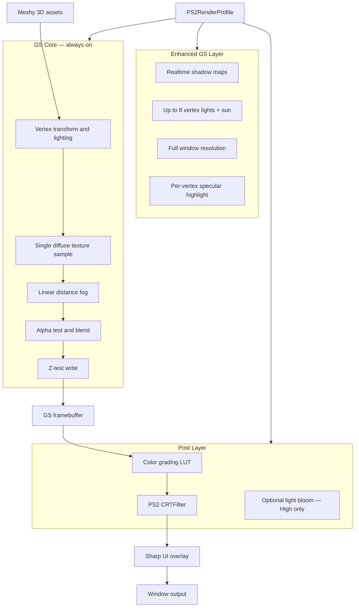

# Enhanced GS Rendering Engine — Technical Specification

**Public name:** Enhanced GS Rendering Engine  
**Tagline:** *An upgraded Graphics Synthesizer chip built for today's PS2-like games.*

Project Dusk renders exclusively through this engine. It is a software reimagining of the PlayStation 2 **Graphics Synthesizer (GS)** fixed-function GPU, enhanced with modern PC headroom while preserving authentic GS visual language.

---

## Design Goals

| Goal | Implementation |
|------|----------------|
| Authentic GS look | Vertex lighting, single diffuse texture, linear fog, alpha test/blend |
| No modern PBR bleed | Material validator rejects URP Lit; quality tiers never enable PBR |
| 60 FPS target | Forward rendering, tier-scaled shadow/light counts |
| Dark arena mood | Heavy fog, harsh industrial lighting, rust/soot palette |
| CRT authenticity | Optional post-process simulating period TV output |
| PC enhancement | Full resolution, larger textures, optional realtime shadows |

---

## Architecture



---

## Real PS2 GS Reference

| GS capability | Real hardware behavior |
|---------------|------------------------|
| Shaders | Fixed T&L + texture combiners only — no programmable shaders |
| Lighting | Vertex lighting (Gouraud); up to 8 lights; diffuse + optional specular |
| Textures | One texture layer per pass; bilinear filtering; mipmaps |
| Color | Vertex color × texture × light; fixed-point math feel |
| Alpha | Alpha test (cutout) and alpha blend |
| Depth | Z-buffer test/write |
| Fog | Linear fog multiplied into final color |
| Effects | Multi-pass tricks — no normal maps, no PBR |
| Output | ~640×448 typical framebuffer |

---

## PS2GSRenderer

Custom **URP Renderer** (`PS2GSRenderer`) replacing default forward renderer for Project Dusk scenes.

### Responsibilities

1. **Material enforcement** — upgrade/import pipeline assigns `PS2/*` shaders; reject non-GS materials in editor validator.
2. **Forward batching** — GS was forward; we stay forward for authenticity and predictability.
3. **Global fog** — push fog start/end/color from `PS2RenderProfile` each frame.
4. **Light culling** — select up to N vertex lights per tier; sun always active.
5. **Shadow maps** — optional per tier (see quality table); sun + dynamic casters.
6. **Multi-pass emissive** — second pass for headlights, windows, hazard signs (GS multi-pass analog).
7. **CRT hook** — inject `PS2CRTFilterPass` after opaque/transparent GS passes, before UI.

### URP Integration

```
Universal Render Pipeline Asset
└── PS2GSRenderer (ScriptableRendererData)
    ├── PS2OpaquePass
    ├── PS2TransparentPass
    ├── PS2ShadowPass (Medium/High)
    ├── PS2CRTFilterPass
    └── (UI renders via separate canvas — unfiltered by default)
```

---

## Shader Family

| Shader | GS behavior | Use |
|--------|-------------|-----|
| `PS2/Lit` | Vertex color × diffuse tex × vertex light + specular; linear fog | Vehicles, buildings, props |
| `PS2/Unlit` | Texture × vertex color; fog | Emissive signs, UI world quads |
| `PS2/AlphaTest` | Clip alpha below threshold; no blend | Fences, grates, foliage |
| `PS2/AlphaBlend` | Standard GS alpha blend | Glass, particles, water surface |
| `PS2/Sky` | Gradient + optional low-res cloud scroll | Skydome |
| `PS2/Water` | UV scroll + vertex color + fog; fake env tint | Toxic pools, water planes |

### PS2/Lit Fragment Math

Simplified GS combiner:

```
final = fog * (vertexColor * texColor * (ambient + sum(lights))) + specularTerm
```

Rules:

- **No** normal maps, metallic, roughness, ORM, SSAO, SSR, or motion blur at any tier.
- Optional **environment tint** on vehicles — single cubemap sample (GS reflection fakery).

---

## PS2RenderProfile

Central `ScriptableObject` read by `PS2GSRenderer` and Settings UI.

### Fields

| Field | Type | Description |
|-------|------|-------------|
| `enhancementTier` | `Low \| Medium \| High` | Master quality selector |
| `fogStart` | float | Linear fog start (meters) |
| `fogEnd` | float | Linear fog end (meters) |
| `fogColor` | Color | Typically soot grey or toxic green tint |
| `maxVertexLights` | int | Active dynamic lights (tier-capped) |
| `shadowMapSize` | int | 0 = disabled |
| `shadowCasterCount` | int | Max dynamic shadow casters |
| `textureMaxSize` | int | Import/runtime cap per tier |
| `specularShininess` | float | GS highlight tightness |
| `crtEnabled` | bool | CRT filter on/off |
| `crtStrength` | float | 0.0 – 1.0 |
| `crtPreset` | `Off \| Low \| Medium \| High` | Scanline/glow/curvature combo |
| `crtFilterMenus` | bool | Apply CRT to UI (default off) |
| `targetFrameRate` | int | Default 60 |

### Quality Tiers

| Feature | Real PS2 | Low | Medium (default) | High |
|---------|----------|-----|------------------|------|
| Output resolution | ~640×448 | 1280×720 | Native window | Native window |
| Target FPS | 30–60 mixed | 60 | 60 | 60 |
| Texture size | 64–256 typical | 256 max | 512 max | 1024 hero / 512 world |
| Filtering | Bilinear | Bilinear | Bilinear + mip bias | Bilinear + light aniso |
| Lighting | 8 vertex lights | 4 + sun | **8 + sun** | **8 + sun** |
| Shadows | Rare / baked | None (vertex AO fake) | **512 px** (sun + 2 casters) | **1024 px** (sun + 8 casters) |
| Draw distance | Short + fog | 80 m fog | 120 m fog | 180 m fog |
| Post | None | None | Color grade LUT + CRT | Color grade + CRT + light bloom |
| Water | N/A | Flat plane | PS2 Water + rain particles | Same + ripple scroll fake |

**Key rule:** Raising quality **never** enables URP Lit/PBR — only GS enhancement knobs.

---

## CRT Filter (`PS2/CRTFilter`)

PS2 games were viewed on CRT televisions. The Enhanced GS Rendering Engine finishes each frame through an optional CRT post-process.

### Effects

| Effect | Implementation |
|--------|----------------|
| Scanlines | Horizontal lines; intensity scales with CRT strength |
| Aperture grille | Soft RGB striping (subtle; off at Low preset) |
| Phosphor glow | Small bloom on bright pixels only |
| Vignette | Darkened corners |
| Chromatic aberration | Very slight RGB split at edges (optional) |
| Curvature | Mild barrel distortion (optional; off at Low) |
| Noise | Light static grain (optional) |

### CRTFilterSettings

Part of `PS2RenderProfile` + persisted in `settings.json`:

- **Enabled** — default **ON**
- **Strength** — slider `0.0 – 1.0` (default `0.6`)
- **Preset:** `Off | Low | Medium | High`

### Integration Order

```
GS scene render → GS framebuffer → CRT pass → Sharp UI overlay → Window output
```

- Disabled by `--no-crt` CLI flag
- Strength via `--crt=low|medium|high`
- Settings → Game tab: CRT toggle, strength slider, preset dropdown
- **60 FPS maintained** — single lightweight fullscreen blit

---

## Art Pipeline Integration

### Meshy.ai 3D Import

1. Import FBX/GLB to `Assets/_ProjectDusk/Art/Models/`
2. Import preset assigns `PS2/Lit` (or `PS2/AlphaTest` for cutouts)
3. Texture max size per active tier (256–1024)
4. `MeshyAssetMetadata` component for traceability

### Venice.ai 2D

UI/HUD sprites are **not** rendered through GS shaders — standard uGUI/SpriteRenderer. They composite **after** CRT pass for sharp readability.

### Twisted Metal Black Visual Mood

- **Palette:** rust, soot black, toxic green accents, sodium-orange industrial lights
- **Arena lighting:** baked gloom + flickering dynamics; enclosed or smog-dome skybox
- **Particles:** exhaust smoke, muzzle flash quads, explosion billboards (PS2 particle style)

---

## Material Validator (Editor)

Editor tool rejects or warns on:

- Materials using URP Lit, Standard, or HDRP shaders
- Normal map slots populated
- Metallic/smoothness maps on vehicle materials

Auto-fix: reassign to nearest `PS2/*` equivalent.

---

## CLI & Settings Integration

| Source | Controls |
|--------|----------|
| `--quality=low\|medium\|high` | Enhancement tier |
| `--fps=60` | Target framerate |
| `--no-crt` | Disable CRT filter |
| `--crt=low\|medium\|high` | CRT preset |
| Settings → Graphics | Same fields persisted to `settings.json` |

See [CLI_FLAGS.md](CLI_FLAGS.md).

---

## Dedicated Server Note

Headless dedicated servers (Phase 4) **skip** `PS2GSRenderer` entirely — no GPU, no CRT. Arena simulation runs without render pipeline initialization.

---

## Related Documents

- [ARCHITECTURE.md](ARCHITECTURE.md) — system overview
- [MESHY_PROMPTS.md](MESHY_PROMPTS.md) — 3D asset guidelines
- [VENICE_PROMPTS.md](VENICE_PROMPTS.md) — 2D HUD/UI art
- [AI_CODED.md](../AI_CODED.md) — AI disclosure for this engine
