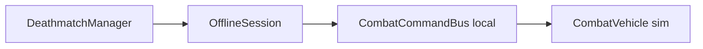
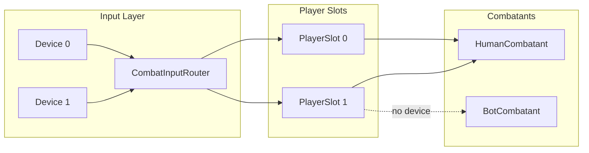
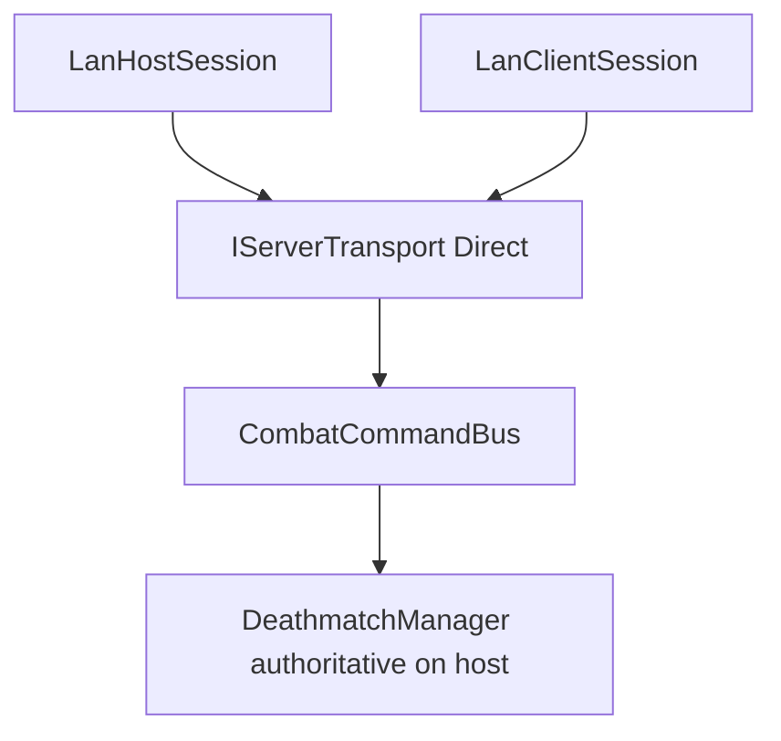
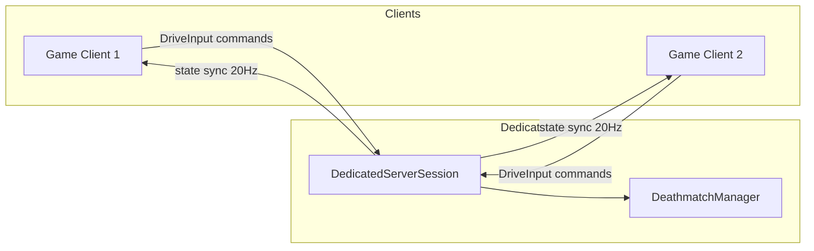

# Multiplayer Architecture

Project Dusk is designed for **couch**, **LAN**, **dedicated server**, and **ranked online** multiplayer — Phase 1 ships offline only, with interfaces and stubs for later phases.

---

## Layer Stack

```
[ Gameplay: DeathmatchManager / CombatCommandBus ]
        ↓
[ Session: INetworkSession — Offline | Lan* | Dedicated | OnlineClient | RankedOnline ]
        ↓
[ Transport: IServerTransport — Direct | Relay | Matchmaking ]
        ↓
[ Online services: IOnlineAccountService / IMatchResultReporter ]  ← Phase 5
        ↓
[ Backend: services/rankings-api REST ] → [ website/ leaderboards ]
```

**Recommended networking library:** [Mirror](https://github.com/MirrorNetworking/Mirror) (MIT) — isolated inside transport/session implementations. Not added in Phase 1.

---

## Session Modes Roadmap

| Mode | Phase | Description |
|------|-------|-------------|
| `Offline` | **1** | Single player vs bots |
| `LocalCouch` | 2 | Same machine, 2–4 players |
| `LanHost` / `LanClient` | 3 | P2P on local IP |
| `DedicatedServer` | 4 | Headless authoritative server |
| `OnlineClient` | 4 | Client connects to public IP / hostname (unranked) |
| `RankedOnline` | 5 | Matchmaking into official ranked pools |

---

## Phase 1 — Offline



- `OfflineSession` implements `INetworkSession`.
- All commands execute locally — no network I/O.
- `CombatCommandBus` still used so LAN/dedicated can swap session without gameplay changes.

---

## Phase 2 — Local Couch Multiplayer



### Core Types

| Type | Role |
|------|------|
| `PlayerSlotRegistry` | Fixed array of 4 slots (`PlayerSlotId` 0–3) |
| `ILocalCombatant` | Human or bot — same spawn/death/damage path |
| `HumanCombatant` | Input from assigned device via `CombatInputRouter` |
| `BotCombatant` | AI fills empty slots |
| `CombatInputRouter` | Maps `InputDevice` → `PlayerSlotId` |
| `MatchConfig` | `humanPlayerCount`, `botCount`, `splitScreen`, `sessionMode` |

### Extension Rules

1. No singleton "the player" — always `PlayerSlotId` → `ILocalCombatant`.
2. Damage/pickups carry `sourceSlotId` / `targetSlotId`.
3. HUD: `CombatHUDController.GetPanel(PlayerSlotId)` — Phase 1 shows slot 0 only.
4. Camera: `VehicleCameraRig` per slot — split-screen enables extra viewports in Phase 2.

### Phase 2 Activation

- Main Menu: **Local Match** → player count (2–4) → per-player vehicle select
- Set `MatchConfig.humanPlayerCount`; reduce `botCount` to fill arena
- Enable split-screen viewports or shared-screen FFA

---

## Phase 3 — LAN (Local IP)



### Flow

| Menu Entry | Flow |
|------------|------|
| **Host LAN Game** | Vehicle select → lobby shows **local IP:port** → wait for joins → start |
| **Join LAN Game** | Enter IP + port (default **7777**) → vehicle select → connect |

### Server-Authoritative Rules

1. **Only the host** runs `DeathmatchManager`, bot AI, pickup timers.
2. Clients send `DriveInputCommand` each tick; host simulates all vehicles.
3. Damage/kills validated server-side via `ApplyDamageCommand`.
4. Bots spawned by host to fill empty slots.
5. **`DeathmatchManager` never branches on LAN vs dedicated** — only checks `INetworkSession.IsServer`.

### CLI (Development)

```bash
ProjectDusk.exe --host-lan
ProjectDusk.exe --join=192.168.1.10:7777
```

### Firewall

- Default port: **7777** (UDP + TCP)
- Document Windows/Linux firewall rules in [BUILD.md](BUILD.md)

---

## Phase 4 — Dedicated Server & Direct Connect



### Deliverables

| Component | Description |
|-----------|-------------|
| `DedicatedServerSession` | Headless `INetworkSession`; no render/UI |
| `ProjectDuskServer.x86_64` | Linux IL2CPP headless build |
| `OnlineClientSession` | Connect to `hostname:port` |
| `IRelayTransport` stub | Future NAT relay |
| `IMatchmakingProvider` stub | Future server browser |

### Headless Server Rules

- **No Enhanced GS render** — skips `PS2GSRenderer`, UI, audio
- CLI: `--dedicated-server --port=7777 --arena=Industrial_01 --bots=2 --max-players=4`
- Docker stub: `tools/docker/Dockerfile`
- Same wire protocol and `ICombatCommand` serialization as LAN

### Menu (Phase 4)

| Entry | Flow |
|-------|------|
| **Connect to Server** | Enter `hostname:port` → vehicle select → join lobby |
| **Host Dedicated Server** | Link to docs — run server binary separately |

---

## Phase 5 — Ranked Online

See [ONLINE_PROFILES.md](ONLINE_PROFILES.md) for profiles, ELO, and rankings API.

- `RankedOnlineSession` queues via `IMatchmakingProvider`
- Dedicated ranked servers post signed results via `IMatchResultReporter`
- Unranked Phase 4 direct connect does **not** affect rankings

---

## CombatCommandBus

All gameplay mutations route through the command bus:

```csharp
interface ICombatCommand { }

// Examples:
// DriveInputCommand, FireWeaponCommand, ApplyDamageCommand,
// PickupTakenCommand, MatchStateChangeCommand

CombatCommandBus.Execute(ICombatCommand cmd);
// Client: serialize and send to server
// Server: validate, apply, broadcast
```

**Rules:**

- No direct `CombatVehicle.TakeDamage()` from input — always via command bus.
- Offline: bus executes immediately.
- Network: server validates rate limits and state before apply.

---

## Sync Table (LAN + Dedicated)

| Data | Rate | Channel | Notes |
|------|------|---------|-------|
| Vehicle transform + velocity | 20 Hz | Unreliable | Interpolate on clients |
| Health/armor, alive flag | On change | Reliable | |
| Weapon fire events | On trigger | Reliable | FX + ammo count |
| Pickup state | On change | Reliable | Server owns pickup table |
| Match timer / phase | 1 Hz | Reliable | Countdown, fighting, ended |

---

## Network Types (Phase 1 Stubs)

| Type | Role |
|------|------|
| `INetworkSession` | Factory by `sessionMode`; Connect/Disconnect |
| `IServerTransport` | Listen, Connect, Send, OnReceive |
| `NetworkEndpoint` | host + port (default 7777) |
| `NetworkPlayerRegistry` | `NetworkPlayerId` ↔ `PlayerSlotId` ↔ `OnlineAccountId` |
| `ILocalCombatant.NetworkPlayerId` | Offline uses `NetworkPlayerId.Local` |

---

## Future Stubs

| Interface | Purpose |
|-----------|---------|
| `IRelayTransport` | NAT traversal when direct connect fails |
| `IMatchmakingProvider` | Server browser, ranked queue, lobby codes |

---

## Phase 1 UI Stubs

| Menu Entry | Phase 1 State |
|------------|---------------|
| Local MP | Disabled — "Coming soon" |
| LAN | Disabled — tooltip shows local IP for dev awareness |
| Online Server | Disabled — "Direct connect — coming later" |
| Ranked Online | Disabled |
| Leaderboards | Disabled — URL placeholder in tooltip |

---

## Related Documents

- [ONLINE_PROFILES.md](ONLINE_PROFILES.md) — ranked flow and profiles
- [CLI_FLAGS.md](CLI_FLAGS.md) — `--host-lan`, `--join`, `--dedicated-server`
- [BUILD.md](BUILD.md) — firewall and server build
- [ARCHITECTURE.md](ARCHITECTURE.md) — system overview
