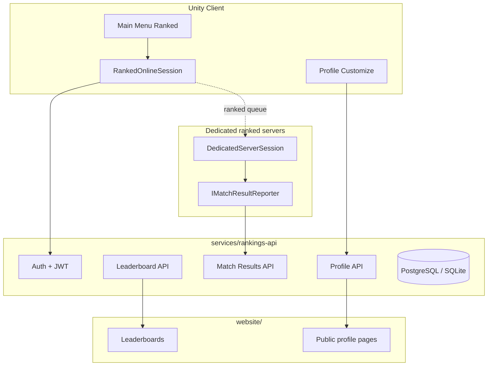

# Online Profiles & Ranked Play

Phase 5 design for **player accounts**, **customizable profiles**, **Gravatar integration**, and **ranked matchmaking**. Phase 1 ships local `OfflinePlayerProfile` in encrypted saves only.

---

## Overview



---

## Account Model

| Field | Storage | Visibility |
|-------|---------|------------|
| `accountId` | UUID, server-generated | Public |
| `email` | Server DB only | **Never public** |
| `passwordHash` | Server DB (bcrypt/argon2) | Never |
| `displayName` | Server DB, unique | Public |
| `gravatarHash` | Server DB (MD5 of email) | **Never public** |
| `createdAt` | Server DB | Public on profile |
| Session JWT | Client encrypted in `.pdusk` online blob | Client only |

Registration and login via game client or website — shared account store.

---

## Player Profile Fields

### OnlinePlayerProfile

| Field | Customization | Phase 1 Local Stub |
|-------|---------------|-------------------|
| `displayName` | Unique, 3–16 chars, filtered | `OfflinePlayerProfile.displayName` in save |
| `avatarSource` | `Preset` \| `Gravatar` | `Preset` only |
| `avatarIconId` | Venice.ai preset grid (~12–24) | Default icon |
| `useGravatar` | Toggle (website + in-game) | Off |
| `bannerId` | Preset industrial banners | Default banner |
| `titleTagId` | Ranked unlock titles | Locked list |
| `accentColorId` | toxic green, rust, amber, soot (4–6 swatches) | Default rust |
| `favoriteVehicleId` | Profile card display | Last Vehicle Select |
| `shortBio` | Optional 80 chars, profanity-filtered | Empty |

**Not a free-form avatar editor** — preset-based customization plus optional Gravatar.

---

## Gravatar Integration

### Privacy Rules

1. **Email never exposed** on public profile, leaderboards, or game API responses.
2. **`gravatarHash`** computed **server-side only**: `MD5(lowercase(trim(email)))`.
3. Public API returns resolved **`avatarUrl`** — clients never build Gravatar URLs from email.
4. Game client calls API for avatar preview — **does not contact Gravatar directly**.

### URL Resolution (Server-Side)

```
https://www.gravatar.com/avatar/{gravatarHash}?s=256&d=404&r=g
```

| Param | Value | Purpose |
|-------|-------|---------|
| `s` | 256 | Size in pixels |
| `d` | 404 | No image → HTTP 404 (trigger fallback) |
| `r` | g | Rated G — family-friendly default |

### Fallback Chain

```
1. If avatarSource=Gravatar && useGravatar && Gravatar returns 200 → use Gravatar image
2. Else → Venice preset sprite /assets/avatars/{avatarIconId}.png
3. Leaderboard thumbnail: 64px with rust ring border (website CSS)
```

---

## Phase 1 In-Game Profile

**Profile menu (Phase 1):**

- Edit **display name** only — stored in encrypted `.pdusk`
- Online fields show locked previews: *"Ranked online — coming later"*
- Gravatar toggle visible but disabled

---

## Phase 5 In-Game Profile

- Full preset picker (avatars, banners, titles, accent colors)
- **Use Gravatar** toggle → syncs `useGravatar` + `avatarSource` via API
- Preview from `GET /api/v1/profile/me/avatar-preview`
- **View on Web** opens `https://projectdusk.example/player/{id}`

---

## Ranked Match Flow

1. Player logs in (in-game or website — shared JWT)
2. **Ranked Online** → `IMatchmakingProvider.QueueRanked()` → official dedicated server
3. Match runs with `MatchConfig.isRanked = true`; all humans must have linked `OnlineAccountId`
4. On match end, server builds **`RankedMatchResult`**:

```json
{
  "matchId": "uuid",
  "arenaId": "Industrial_01",
  "seasonId": "2026-s1",
  "durationSeconds": 142,
  "players": [
    {
      "accountId": "uuid",
      "placement": 1,
      "kills": 3,
      "deaths": 1,
      "damageDealt": 4200
    }
  ]
}
```

5. `IMatchResultReporter` POSTs **HMAC-signed** payload to `/api/v1/matches/ranked`
6. API updates ELO / rank tier + match history; website leaderboards refresh

### Integrity Rules

- **Only dedicated servers** with shared HMAC secret may POST ranked results
- Clients **cannot** submit wins or stats directly
- Unranked matches (`OnlineClient` direct connect) **excluded** from rankings

---

## Ranking Model

### Seasons

- **3-month seasons** (configurable)
- Season rollover archives leaderboards; soft reset option documented in API

### Stats Tracked

| Stat | Description |
|------|-------------|
| Wins / Losses | Match outcomes |
| K/D | Kills per death |
| Average placement | Mean finish position |
| Rank tier | Bronze → Silver → Gold → Platinum → Champion (stub) |
| Arena-specific | Separate boards per `arenaId` |

### ELO (Stub Formula)

```
expectedScore = 1 / (1 + 10^((opponentElo - playerElo) / 400))
newElo = playerElo + K * (actualScore - expectedScore)
```

- `K` factor higher for placement matches
- Tier thresholds derived from ELO bands

---

## Rankings API Endpoints

Base URL: `https://api.projectdusk.example` (configure at deploy)

| Method | Path | Auth | Purpose |
|--------|------|------|---------|
| POST | `/api/v1/auth/register` | — | Create account |
| POST | `/api/v1/auth/login` | — | JWT access + refresh |
| POST | `/api/v1/auth/refresh` | Refresh token | New access token |
| GET | `/api/v1/profile/me` | JWT | Authenticated profile |
| PATCH | `/api/v1/profile/me` | JWT | Update customization |
| GET | `/api/v1/profile/me/avatar-preview` | JWT | Resolved avatarUrl |
| GET | `/api/v1/profile/{id}` | — | Public profile (no email) |
| POST | `/api/v1/matches/ranked` | HMAC server | Ingest match result |
| GET | `/api/v1/leaderboards` | — | `?season=&arena=&limit=` |
| GET | `/api/v1/matches/{id}` | — | Match detail for history |
| DELETE | `/api/v1/account` | JWT | GDPR delete stub |

### Public Profile Response Example

```json
{
  "accountId": "550e8400-e29b-41d4-a716-446655440000",
  "displayName": "RustDriver",
  "avatarUrl": "https://cdn.projectdusk.example/avatars/preset/rust-helmet-03.png",
  "bannerId": "foundry-night",
  "titleTagId": "rustbucket-veteran",
  "accentColorId": "toxic-green",
  "favoriteVehicleId": "rustbucket",
  "shortBio": "Arena rat since season 1.",
  "stats": {
    "wins": 42,
    "losses": 38,
    "kd": 1.4,
    "tier": "Gold",
    "elo": 1480
  }
}
```

---

## Save File Integration

Encrypted `.pdusk` may store an `online` blob — see [SAVE_FORMAT.md](SAVE_FORMAT.md):

- `refreshTokenHash` (not plaintext token)
- Cached `OnlinePlayerProfile` for offline display
- Last sync timestamp

JWT access tokens are **memory-only** during session — not persisted plaintext.

---

## Phase 1 Stubs

| Component | Location | Status |
|-----------|----------|--------|
| `IOnlineAccountService` | `Scripts/Online/` | Interface only |
| `IPlayerProfileClient` | `Scripts/Online/` | Interface only |
| `IMatchResultReporter` | `Scripts/Online/` | Interface only |
| `OfflinePlayerProfile` | `Scripts/Core/` | **Functional** |
| `services/rankings-api/` | Repo root | OpenAPI skeleton README |
| Ranked menu | Main Menu | Disabled |

---

## GDPR / Account Deletion (Stub)

- `DELETE /api/v1/account` removes profile, match history, and Gravatar hash association
- Email retained in deletion audit log for 30 days (configurable) — document in privacy policy

---

## Related Documents

- [WEBSITE.md](WEBSITE.md) — leaderboard site and Gravatar UI
- [MULTIPLAYER.md](MULTIPLAYER.md) — ranked session architecture
- [SAVE_FORMAT.md](SAVE_FORMAT.md) — online blob in `.pdusk`
- [VENICE_PROMPTS.md](VENICE_PROMPTS.md) — avatar preset art
